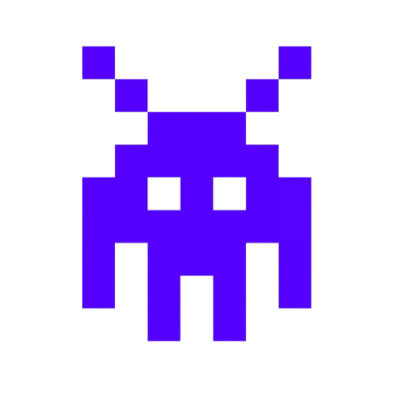

<p align="center"></p>

# CGD — Compilador Geral Delégua

Frontend em **D**, saída **C99**, executáveis nativos e runtime gerenciado em C.
O CGD implementa um perfil compilado de
[Delégua, da Design Líquido](https://github.com/DesignLiquido/delegua), mantendo
sua referência à [wiki oficial](https://github.com/DesignLiquido/delegua/wiki).
Este repositório é uma implementação própria, com limites documentados; não é o
interpretador original nem oferece todos os seus ambientes e extensões.

**[Website](https://fernandothedev.github.io/cgd/)** ·
**[Guia da linguagem e compatibilidade](https://fernandothedev.github.io/cgd/linguagem.html)** ·
[Exemplos executáveis](exemplos/README.md) ·
[Desenvolvimento e passes](docs/desenvolvimento.md) ·
[Contexto para agentes](AGENTS.md)

## Instalar as dependências

Ambiente validado: **Linux x86_64**. São necessários DMD ou LDC2, DUB, Clang ou
GCC, pkg-config, Boehm GC e libcurl >= 7.86 com headers. Python 3 é usado no build
do runtime, nos testes e ferramentas; não é necessário para executar o programa gerado.

```sh
# Debian / Ubuntu
sudo apt-get update
sudo apt-get install git build-essential clang pkg-config libgc-dev libcurl4-openssl-dev ldc dub python3

# Fedora
sudo dnf install git gcc clang pkgconf-pkg-config gc-devel libcurl-devel ldc dub python3

# Arch Linux
sudo pacman -S --needed git gcc clang pkgconf gc curl ldc dub python
```

Alternativas: [DMD](https://dlang.org/download.html),
[LDC](https://github.com/ldc-developers/ldc),
[Boehm GC](https://github.com/bdwgc/bdwgc). Os nomes dos pacotes podem variar.
Os binários gerados dependem das bibliotecas nativas vinculadas; não são binários
estáticos automaticamente portáveis entre sistemas.

## Build do zero

```sh
git clone --branch dev --recurse-submodules https://github.com/FernandoTheDev/cgd.git
cd cgd

# Em checkouts existentes:
git submodule update --init --recursive

./build-runtime
dub build --compiler=ldc2 --build=release
# Alternativa: dub build --compiler=dmd --build=release
```

`CC=gcc ./build-runtime` seleciona GCC para o runtime. O script usa o commit local
do vendor e não faz pull automaticamente. O vendor já possui Git próprio como submódulo; pode ser editado e commitado
daqui com `git -C vendor/delegua-runtime`. Veja o [fluxo de trabalho](docs/desenvolvimento.md#editar-o-runtime-a-partir-deste-checkout).
O runtime é desenvolvido em
[FernandoTheDev/delegua-runtime](https://github.com/FernandoTheDev/delegua-runtime).

## Instalar no usuário

```sh
./instalar --compiler ldc2 --release
export PATH="$HOME/.local/bin:$PATH"
cgd --versao
```

A instalação copia executável, headers e runtime para `~/.local/share/cgd` e cria
um link em `~/.local/bin/cgd`, sem sudo. Use `--prefix DIRETORIO` e
`--bin-dir DIRETORIO` para outros destinos; `--no-build` reutiliza um build existente.
Para remover a instalação padrão: apague o link `~/.local/bin/cgd` e o diretório
`~/.local/share/cgd`. Não há instalação automática de pacotes do sistema.

## Primeiro programa

```sh
mkdir -p out
./cgd exemplos/linguagem/14_classes.delegua -o -s out/classes
./out/classes

# Análise sem toolchain C e diagnósticos consumíveis por ferramentas:
./cgd exemplos/linguagem/14_classes.delegua --verificar --diagnosticos=json

# C intermediário, sem link:
./cgd exemplos/linguagem/14_classes.delegua --emitir-c -o -s out/classes
./cgd --explicar E3101
./cgd --ajuda
```

**`-o` ativa otimizações; `-s` define o destino.** Crie o diretório de saída antes.
O `.c` fica ao lado do executável. `CC=gcc` ou `--cc gcc` seleciona o backend C.
Opções de alvo, sysroot e runtime estão no [guia de desenvolvimento](docs/desenvolvimento.md).
A configuração de cross compilation está separada do hospedeiro; Windows e
executáveis cruzados ainda não foram validados.

## Trabalhar no projeto

```sh
dub test --compiler=dmd --config=unittest
dub test --compiler=ldc2 --config=unittest
python3 testes/driver.py
python3 testes/integracao.py
python3 testes/exemplos.py
python3 testes/lsp.py
python3 testes/bibliotecas.py
python3 testes/formatador.py
python3 scripts/verificar_tipos.py
python3 scripts/validar.py         # matriz DMD/LDC2 × debug/release × Clang/GCC
python3 scripts/sanitizadores.py   # ASan/UBSan; restaura o runtime normal
python3 scripts/formatar.py --check
python3 scripts/gerar_referencia.py --check
python3 testes/site.py --static-only
```

Detalhes de formatadores, contratos de otimização, diagnósticos e novos passes:
[Desenvolvimento](docs/desenvolvimento.md). O mapa do código e a ABI estão em
[Arquitetura](docs/arquitetura.md); evidências e limitações dos testes estão em
[Validação](docs/validacao.md). Relatórios e artefatos são gravados em `out/`.
O QA de navegador usa Chrome/Chromium e `requirements-site.txt`.

A branch de integração é `dev`. Atualize o runtime explicitamente, preservando
alterações locais. Quando houver mudanças no submódulo, publique seu commit
antes de atualizar a referência no CGD. Evite versionar executáveis e C gerado.
Mantenha testes com e sem otimização e acrescente regressões para cada mudança
observável. Rode `git diff --check` nos dois repositórios.

Capturas/upvalues e carregamento dinâmico continuam excluídos. A FFI C por classes
estrangeiras foi introduzida por solicitação explícita; seus contratos e limites
estão em [Evolução da linguagem](docs/evolucao-linguagem.md).
Outros limites de implementação são descritos separadamente em
[Compatibilidade](docs/compatibilidade.md) e [Segurança](docs/seguranca.md).

Licença [Apache-2.0](LICENSE). Autoria e referências ao projeto Delégua devem ser
preservadas. [Apoie o desenvolvimento](https://www.patreon.com/fernandothedev).

## Editor e bibliotecas

A [extensão VS Code própria](extensao-vscode/README.md) usa o LSP local do CGD,
com tokens semânticos, navegação, completion contextual e formatação com quatro
espaços (Ctrl+Shift+I). Compile o CGD uma vez e instale com
`python3 scripts/instalar_extensao.py --associate`. Não há compilação por edição.

Consulte [bibliotecas e ferramentas](docs/ferramentas.md) para JSON em Delégua puro,
rede com libcurl gerenciada, coleções, instalação da extensão e limites reais.
O [registro de continuidade](docs/CONTINUIDADE.md) distingue entregas e pendências.

A [referência web própria](docs/linguagem.html) cobre instalação, linguagem, editor,
runtime e biblioteca padrão. [Bibliotecas e ferramentas](docs/ferramentas.md)
detalha APIs e limites. Compatibilidade JS, herança de interfaces e múltiplos
dialetos são exclusões definitivas do projeto.
